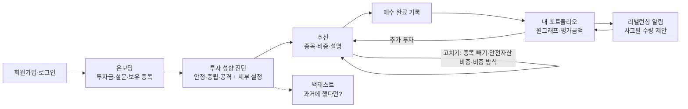
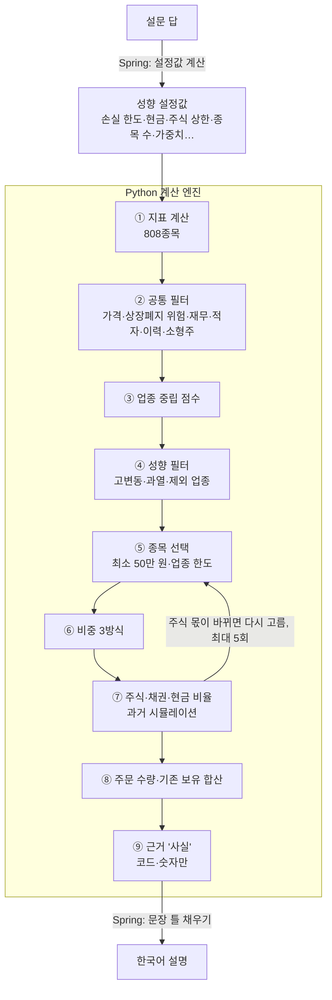
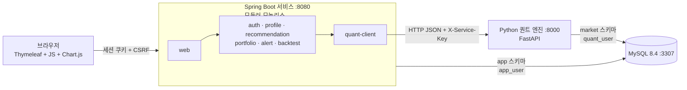

# 성향별 멀티팩터 포트폴리오

> 데이터처리프로그래밍 2조 수업 프로젝트입니다. **투자 권유가 아니며**, 실제 주문은 하지 않습니다.

투자 성향 설문에 답하면, 그 사람에게 맞는 **KOSPI 종목과 주식·채권·현금 비율**을 추천하고,
왜 그렇게 골랐는지 한국어로 설명해 주는 웹 서비스입니다.
산 뒤에는 포트폴리오를 계속 지켜보다가 비중이 한쪽으로 쏠리면 알려 주고,
같은 방법을 과거에 썼다면 어땠을지 **백테스트**로 확인할 수 있습니다.

이 서비스의 목표는 수익률을 최대로 올리는 것이 아니라, **받은 포트폴리오를 사용자가 이해하고 납득하게 하는 것**입니다
([기획_결정기록.md](기획_결정기록.md) 결정 1).

아래 링크는 해당 서비스의 실행 영상입니다
https://youtu.be/_YFKWLxnkbk?si=ucO8rg8Jm12iunyu
---

## 목차

1. [한눈에 보기](#1-한눈에-보기)
2. [실행하기](#2-실행하기)
3. [화면과 사용 흐름](#3-화면과-사용-흐름)
4. [용어 풀이](#4-용어-풀이)
5. [추천은 이렇게 만들어져요](#5-추천은-이렇게-만들어져요)
6. [포트폴리오 추적과 리밸런싱 알림](#6-포트폴리오-추적과-리밸런싱-알림)
7. [백테스트](#7-백테스트)
8. [시스템 구조 (개발자용)](#8-시스템-구조-개발자용)
9. [데이터](#9-데이터)
10. [폴더 구조](#10-폴더-구조)
11. [테스트](#11-테스트)
12. [한계와 향후 계획](#12-한계와-향후-계획)
13. [문서 지도](#13-문서-지도)

---

## 1. 한눈에 보기

### 무엇을 하나요



| 단계 | 쉬운 말 | 실제로 하는 일 |
|---|---|---|
| 성향 진단 | "얼마나 잃어도 괜찮으세요?" 같은 질문 13개 | 강의 자료의 투자성향 7문항 점수 + 추가 6문항 → 손실 한도·현금 비율·종목 수 등 설정값 |
| 추천 | 살 종목과 비율, 그리고 이유 | 재무·가격 지표로 종목 점수 → 성향에 맞게 거르기 → 비중 → 과거 시뮬레이션으로 주식·채권·현금 비율 |
| 매수 완료 | "이대로 샀어요" 버튼 | 추천 수량을 내 보유에 기록하고 목표 비중을 저장 (실제 주문은 사용자가 증권사에서) |
| 추적·알림 | 비중이 쏠리면 알려 줌 | 최신 종가로 평가해 R1~R7 조건 판정, 되돌리는 매도·매수 수량 제안 |
| 백테스트 | "2015년부터 이렇게 했다면?" | 매년 4월 같은 규칙으로 종목을 바꾸며 자산 가치를 날마다 계산 |

### 범위

- **KOSPI 상장 주식**만 다룹니다 (808종목). 채권은 국고채 3년 금리로 계산한 지수, 현금은 이자 0으로 봅니다.
- 최소 투자 금액은 **2,000만 원**입니다 (결정 2-3).
- 가격은 **하루 한 번 종가** 기준입니다. 단기매매 서비스가 아니라서 실시간 시세는 쓰지 않습니다 (결정 4-5).
- 데이터는 수업 제공 파일 기준 **2010-01-04 ~ 2026-08-19**입니다.
- 서비스 안에 **AI(생성형 모델)를 쓰지 않습니다.** 설명 문장은 정해진 틀(템플릿)에 계산 결과를 채워 만듭니다.

---

## 2. 실행하기

필요한 것: **Docker Desktop**, **JDK 21**(Gradle이 자동으로 받음), 개발할 때는 **Python 3.12**.

**① MySQL과 계산 엔진 띄우기** (이 폴더에서)
```bash
docker compose up -d mysql quant-engine
```
엔진이 시장 데이터를 메모리에 올리는 데 수십 초 걸립니다. MySQL은 PC에 설치된 MySQL(3306)과 겹치지 않게 **3307** 포트를 씁니다.

처음 받은 PC라 데이터가 없다면 한 번 적재합니다 (약 3분). 끝나면 엔진을 다시 켭니다.
```bash
docker compose exec quant-engine python -m app.etl.load_base
```
```bash
docker compose restart quant-engine
```

**② 웹 서비스 실행** (PowerShell이면 `./gradlew` 대신 `.\gradlew.bat`)
```bash
cd service
```
```bash
./gradlew :app:bootRun --args=--spring.profiles.active=local
```
"Started PortfolioApplication"이 보이면 http://localhost:8080 에 접속합니다.

**③ 로그인** — 직접 가입해도 되고, 로컬 테스트 계정을 써도 됩니다.

| 아이디 | 비밀번호 | 상태 |
|---|---|---|
| `demouser` | `demo-pass-2026` | 온보딩만 마침 (추천 화면부터 볼 때) |
| `demobuyer` | `demo-pass-2026` | 매수 완료까지 마침 (포트폴리오·알림·백테스트 볼 때) |

**끄기**: 웹 서비스는 Ctrl+C, 나머지는 아래 명령입니다.
```bash
docker compose stop
```

| 실행 방법 | 언제 |
|---|---|
| `--spring.profiles.active=local` | 평소. 실제 엔진(`http://127.0.0.1:8000`)을 부름 |
| `--spring.profiles.active=stub` | 엔진 없이 화면만 볼 때. 미리 저장한 실제 엔진 응답(대역)을 씀 — 추천·백테스트 결과가 늘 같음 |
| 포트 바꾸기 | `PORT=8081 ./gradlew :app:bootRun ...` |

각 부분의 자세한 실행법: [service/README.md](service/README.md), [quant-engine/README.md](quant-engine/README.md)

---

## 3. 화면과 사용 흐름

| 경로 | 화면 | 하는 일 |
|---|---|---|
| `/signup`, `/login` | 가입·로그인 | 아이디(영문·숫자 4~20자) + 비밀번호(8~64자) |
| `/onboarding` | 단계형 설문 | ① 투자 금액 ② 투자성향 7문항 ③ 추가 6문항 ④ 갖고 있는 종목 검색·수량 ⑤ 확인 |
| `/profile` | 내 투자 성향 | 등급, 손실 한도, 현금 최소 비중, 주식 상한, 종목 수, 팩터 가중치 막대, **추천 받기** |
| `/profile/survey` | 재진단 | 같은 설문을 다시 (이전 답이 채워져 있음) |
| `/recommendations/{id}` | 추천 결과 | 아래 참고 |
| `/portfolio` | 내 포트폴리오 | 아래 참고 (매수 완료 후) |
| `/alerts/{id}` | 리밸런싱 제안 | 사고팔 종목·수량, 거래 전·후 비중, "이대로 했어요" |
| `/backtests`, `/backtests/{id}` | 백테스트 | 실행·목록, 결과 그래프·표·CSV |

홈(`/`)은 상태에 따라 알아서 보냅니다: 온보딩 전 → 온보딩, 매수 완료 후 → 포트폴리오, 추천이 있으면 → 최근 추천, 아니면 → 프로필.

### 추천 화면에서 할 수 있는 것

- **원그래프** — 바깥 고리는 주식·채권·현금, 안쪽 고리는 종목. 조각에 마우스를 올리면 종목명·주 수·금액.
- **이렇게 나눈 이유** — "현금 39%: 1년 안에 쓸 돈이 '10% 이하'라고 하셔서…" 같은 문장.
- **종목별 근거** — 종목 줄을 누르면 고른 이유, PER·PBR·ROE, 성향과의 연결, 주의할 점, 분산 효과.
- **비중 방식 탭** — 동일가중 / 변동성 역수가중 / 최소분산을 미리 보고 골라서 확정.
- **종목 빼기** — 빼면 다음 순위 종목이 들어오고 새 **버전**으로 저장 (지난 버전도 볼 수 있음).
- **안전자산(채권+현금) 비중 슬라이더** — 직접 정하면 손실 한도를 넘을 때 경고.
- **이 종목은 왜 없나요?** — 아무 종목이나 검색하면 빠진 이유 한 줄 ("전기·전자 41개 중 10위라 순위 밖이에요").
- **갖고 계신 것과 합치면** — 기존 보유를 더한 전체 목표 비중 (이후 알림의 기준).
- **이 설정으로 과거에 운용했다면** — 2015년부터의 누적 수익률, 최대 하락, 가장 나빴던 해.
- **이대로 샀어요** — 매수 완료 기록 (최신 버전·가장 최근 추천만 가능).

### 포트폴리오 화면에서 할 수 있는 것

- **리밸런싱 알림** 목록 (맨 위) — "어떻게 고칠까요?"로 제안 화면, "닫기"로 숨김.
- **총 평가금액**과 원그래프 — 종목 조각을 누르면 평가금액·수량·현재가·평균 매입가·수익률·현재/목표 비중.
- **목표와 비교** — 자산마다 목표 비중, 5%p 넘게 벌어지면 빨갛게.
- **업종 비중** 막대와 업종 한도 선.
- **직접 고치기** — 수량·평균가·종목 추가/삭제·채권·현금. **입력하는 동안 그래프와 비중이 바로 바뀌고**, 저장해야 반영.
- **추가로 투자하기** — 새 금액을 넣으면 지금 보유와 합쳐 새 돈을 어디에 나눌지 추천.

---

## 4. 용어 풀이

| 용어 | 쉬운 말 | 이 서비스에서 |
|---|---|---|
| 포트폴리오 | 내가 가진 자산 묶음 | 주식 여러 종목 + 채권 + 현금 |
| 팩터(factor) | 종목을 고르는 기준 하나 | 가치·수익성·추세·안정성·배당 5개 |
| 멀티팩터 | 여러 기준을 섞어 점수 매기기 | 5개 팩터 점수를 성향별 가중치로 합침 |
| PER (주가수익비율) | 주가가 1년 이익의 몇 배인가. 낮을수록 "싸다" | 가치 팩터 |
| PBR (주가순자산비율) | 주가가 회사 순자산의 몇 배인가 | 가치 팩터 |
| PSR · PCR | 주가를 매출·현금흐름과 비교 | 가치 팩터 |
| ROE · ROA | 자기자본·총자산으로 이익을 얼마나 내나 | 수익성(QUALITY) 팩터 |
| 모멘텀 | 최근 6개월 동안 오른 정도 | 추세(MOMENTUM) 팩터 |
| 부채비율 | 빚이 자기자본의 몇 배인가 | 안정성(STABILITY) 팩터, 낮을수록 좋음 |
| 배당수익률 | 주가 대비 배당금 | 배당(DIVIDEND) 팩터 |
| 변동성 | 가격이 얼마나 출렁이나 (1년 일간 수익률 표준편차 × √252) | 너무 큰 종목은 성향에 따라 뺌 |
| RSI | 최근 14일 오름·내림 힘의 비율. 0.7 이상이면 "단기 과열" | 안정·중립형은 과열 종목을 뺌 |
| 업종 중립 점수 | 같은 업종 안에서 순위를 매김 (은행과 IT를 PER로 직접 비교하지 않으려고) | 업종 그룹이 10종목 미만이면 전체와 비교 |
| 동일가중 | 종목마다 같은 금액 | 공격형 기본 |
| 변동성 역수가중 | 덜 출렁이는 종목에 더 많이 | 중립형 기본 |
| 최소분산 | 종목 사이 움직임까지 따져 전체 출렁임이 가장 작게 | 안정형 기본 |
| MDD (최대 낙폭) | 가장 높았던 때에서 가장 많이 떨어진 비율 | "손실 한도"와 비교하는 값 |
| 손실 한도 | "이 이상 떨어지면 못 견딘다" | 설문 Q7 → -3% / -5% / -10% / -20% / 제한 없음 |
| 국고채 3년 · 듀레이션 | 정부가 3년 빌리는 금리. 듀레이션은 금리가 1%p 오를 때 채권값이 몇 % 빠지나(여기선 2.8) | 금리로 채권 지수를 계산 |
| 리밸런싱 | 쏠린 비중을 목표로 되돌리기 | 알림 + 사고팔 수량 제안 |
| 백테스트 | 과거 데이터로 "그때 이렇게 했다면" 계산 | 실험 A~D |
| NAV | 시작을 100으로 둔 자산 가치 | 백테스트 그래프 |
| CAGR (연환산 수익률) | 해마다 평균 몇 %씩 불었나 | 백테스트 지표 |
| 샤프 · 소르티노 | 출렁임 대비 수익 (소르티노는 떨어지는 출렁임만 봄) | 백테스트 지표 |
| 생존 편향 | 지금 살아남은 종목만 보고 과거를 판단하면 결과가 좋게 나옴 | 백테스트 한계로 표시 |
| 상장폐지 위험 (D1~D5) | 곧 상장폐지될 수 있는 신호 | 시가총액·매출·주가·자본잠식·관리종목 기준으로 미리 뺌 |

---

## 5. 추천은 이렇게 만들어져요



### 5.1 설문 → 설정값 (Spring `profile` 모듈)

투자성향 7문항은 강의 자료 원문이고, 선택지 1~5번에 **5·4·2·1·0점**을 줍니다. 합계로 등급을 정합니다.

| 총점 | 등급 |
|---|---|
| 10점 이하 | 안정추구형 (STABLE) |
| 11~24점 | 위험중립형 (NEUTRAL) |
| 25점 이상 | 공격추구형 (AGGRESSIVE) |

추가 6문항(A2~A7)과 함께 아래 **설정값**을 만듭니다. 엔진은 설문을 모르고 이 값만 받습니다.

| 설정값 | 정하는 곳 | 값 |
|---|---|---|
| 손실 한도 | Q7 (3개월 손실에 대한 생각) | 1번 제한 없음 / 2번 -20% / 3번 -10% / 4번 -5% / 5번 -3% |
| 현금 최소 비중 | A2 (1년 안에 쓸 돈) + A3 (비상금) | 없음 0% · 10% 이하 10% · 10~30% 30% · 30% 이상 50%, 비상금 없으면 +5%p |
| 주식 상한 | 등급 + A4 (전체 자산 중 이 돈의 비중) | 안정 40% · 중립 60% · 공격 90%, A4가 크면 -5%p·-10%p |
| 종목 수 | A5 | 10 / 15 / 20 / 상관없음(15) |
| 팩터 가중치 | 등급 기본값 + A6 (끌리는 스타일마다 +0.10, 합 1로) | 중립 기본: 가치 0.30 · 수익성 0.30 · 추세 0.25 · 안정성 0.15 · 배당 0 |
| 종목·업종 한도 (주식 안) | 등급 | 안정 15%·30% / 중립 20%·40% / 공격 25%·50% |
| 기본 비중 방식 | 등급 | 안정 최소분산 / 중립 변동성 역수 / 공격 동일가중 |
| 변동성 상위 제외 · 과열 제외 | 등급 (Q2 투자 기간이 1년 이내면 안정형 기준) | 안정 30%·예 / 중립 10%·예 / 공격 0%·아니오 |
| 제외 업종 | A7 | 고른 업종 |

값 전체: [service/app/src/main/resources/application.yml](service/app/src/main/resources/application.yml)의 `portfolio.profile`

### 5.2 종목 거르기 (엔진 `domain/screening.py`)

**공통 필터** — 순서대로, 처음 걸린 이유 하나만 기록합니다 ("왜 없나요"에 쓰임).

| 순서 | 이유 | 기준 |
|---|---|---|
| 1 | 가격 없음 | 최근 거래 가격이 없음 |
| 2 | **상장폐지 위험** | D1 시가총액 500억 미만 · D2 매출 300억 미만(금융업 제외) · D3 주가 1,000원 미만 · D4 자본잠식 50% 이상 · D5 관리종목 |
| 3 | 재무 자료 없음 | 최신 회계연도 재무 결측 |
| 4 | 적자 | PER·PBR·ROE 등 수익 지표를 계산할 수 없음 |
| 5 | 이력 부족 | 6개월 수익률·1년 변동성 등을 계산할 만큼 거래 기록이 없음 (1년 내내 가격이 그대로인 거래정지 종목 포함) |
| 6 | 소형주 | 남은 종목 중 시가총액 하위 10% |

2026-08-19 기준 808종목 → **432종목**이 후보로 남습니다.

**성향 필터** (점수 계산 뒤) — 변동성 상위 N% 제외, RSI 0.70 이상 과열 제외, 제외 업종.

### 5.3 점수와 선택

- 지표마다 **업종 안 순위**(0~1)를 매기고 팩터별로 평균 → 성향 가중치로 합쳐 총점.
- 총점 순서대로 담되, **종목당 최소 50만 원**(주식 몫 ÷ 50만 원보다 많이 담지 않음), **1주 가격이 배정 금액보다 크면 건너뜀**, **기존 보유와 합친 업종 비중이 한도를 넘으면 건너뜀**.

### 5.4 비중 3방식 (`domain/weighting.py`)

세 방식 모두 계산해 화면 탭으로 보여 줍니다. 종목당 한도는 `max(성향 한도, 1/종목 수)`. 최소분산은 최근 1년 수익률로 공분산을 구해 SciPy(SLSQP)로 풀고, 자료가 부족하면 변동성 역수로 대신합니다.

### 5.5 주식·채권·현금 비율 (`domain/allocation.py`) — 핵심

고른 종목과 비중으로 **2010년 이후 시장을 그대로 다시 겪어 보고**, 1%p 단위로 아래 순서대로 고릅니다.

1. **주식을 최대로** — 단, 그 기간 최대 하락이 **손실 한도의 70%** 안 (주식 상한 이하)
2. **채권을 최대로** — 단, **금리가 2%p 오르는 충격**(채권 약 -5.6%)에도 채권 손실이 한도의 70% 안
3. 나머지는 **현금** (현금 최소 비중 이상)

> **왜 여유(70%)와 금리 충격을 두나요?** — 처음에는 "과거 7년 최대 하락 = 한도"로 딱 맞췄는데, 백테스트에서 한도가 자주 깨졌습니다. 코로나 때 고른 주식은 1년에 -48% 떨어졌지만 과거 7년 최악은 -24%였고, 2022년 금리 인상 때 채권은 -6.5% 떨어졌지만 과거 7년 최악은 -1.4%였기 때문입니다. 세 가지를 고친 뒤 -10% 프로필의 한도 위반은 273일 → 28일, 최대 하락 -24.5% → -11.3%로 줄었습니다 (결정 8-5b). 그래도 손실 한도는 **보장이 아니라 목표**입니다.

### 5.6 주문·합산·경고

- 주식 수는 **1주 단위로 내림**, 남은 돈은 현금에 더하고 따로 표시합니다.
- 기존 보유와 합친 **전체 목표 비중**과 전체 예상 하락을 계산합니다.
- 경고: 종목 수를 줄였을 때(`N_REDUCED`), 기존 보유까지 합치면 한도를 넘을 때(`COMBINED_LOSS_LIMIT`), 직접 정한 안전자산 비중이 한도를 넘을 때(`LOSS_LIMIT_EXCEEDED`), 주식이 0일 때, 최소분산 계산이 안 돼 대신했을 때.

### 5.7 설명 문장 — "엔진은 사실, Spring은 문장"

엔진은 `{"top_factors": ["VALUE","QUALITY"], "group": "운송장비·부품", "group_n": 41, "rank_in_group": 2}` 같은 **코드와 숫자만** 돌려줍니다.
Spring이 [messages_reasons.properties](service/recommendation/src/main/resources/messages_reasons.properties)의 틀에 채워 "운송장비·부품 41개 종목 중 가치·수익성 점수가 높아요 (업종 안 2위)"를 만듭니다. 문장을 바꾸려면 이 파일만 고치면 됩니다.

### 5.8 예시 (테스트에 고정된 기준값)

위험중립형(손실 한도 -10%, 현금 최소 15%), 투자금 3,000만 원, 삼성전자 20주 보유 → **주식 8%(4종목) · 채권 53% · 현금 39%**, 2010년 이후 기준 예상 최대 하락 -7.0%.
삼성전자 보유분까지 합치면 전체 예상 하락이 -11.3%라 "합치면 한도를 넘어요" 경고가 함께 나옵니다. 계산 시간은 약 1~2초입니다.

---

## 6. 포트폴리오 추적과 리밸런싱 알림

포트폴리오를 열 때마다 엔진이 최신 종가로 평가하고, 아래 조건이 성립하는지 판정합니다. Spring은 알림을 **열고·갱신하고·닫는 상태**만 관리합니다.

| 알림 | 언제 | 제안 (사고팔 수량) |
|---|---|---|
| R1 종목 쏠림 | 한 종목이 주식 안에서 종목 한도 초과 | 그 종목을 한도까지 줄이고 다른 추천 종목에 비중대로 나눔 |
| R2 업종 쏠림 | 한 업종이 업종 한도 초과 | 그 업종을 한도까지 줄임 |
| R3 목표 이탈 | 어떤 자산이 목표에서 5%p 넘게 벌어짐 | 매수 완료 때 정한 목표로 되돌림 |
| R4 안전자산 감소 | 채권+현금이 목표보다 5%p 넘게 줄어듦 | 목표로 되돌림 |
| R5 손실 한도 근접 | 고점 대비 하락이 한도의 80%에 닿음 | 목표로 되돌림 (+ 재진단 권유) |
| R6 정기 점검 | 매년 4월 첫 영업일 이후 (새 재무 반영) | 같은 성향으로 지금 총액을 처음부터 다시 추천받은 비중 (종목 교체는 이때만) |
| R7 상장폐지 위험 | 보유 종목이 D1~D5에 걸림 | 그 종목을 모두 팔고 다른 추천 종목에 나눔 |

- 같은 알림은 해소될 때까지 **하나만** 유지합니다. "닫기"하면 조건이 사라졌다 다시 생길 때까지 안 뜹니다.
- 제안 화면의 **"이대로 했어요"**는 수량·채권·현금과 **목표 비중**을 함께 바꿉니다 (판 종목은 평균가 유지, 더 산 종목은 평균가 재계산).
- 1주 단위로 내림해 계산하므로 거래 후 비중은 목표의 ±1%p 안에 들어옵니다 (테스트로 확인).

---

## 7. 백테스트

"이 규칙을 2015년부터 썼다면?"을 계산합니다. 매년 **4월 1일 이후 첫 영업일**(새 재무가 반영되는 날)에 종목을 바꾸고, 그날까지 알 수 있던 데이터만 씁니다(미래 정보 차단). 거래할 때마다 거래 금액의 0.3%를 비용으로 뺍니다.

| 실험 | 묻는 것 | 전략 |
|---|---|---|
| A | 어떤 팩터가 통했나? | 팩터 하나로 고른 15종목 ×5, 멀티팩터(업종 안 순위), 멀티팩터(전체 순위) |
| B | 비중 방식에 따라 다른가? | 같은 15종목을 동일가중·변동성 역수·최소분산 |
| C | 코스피보다 나은가? | 멀티팩터 동일가중 vs 코스피 지수 |
| D | 이 서비스를 그대로 따랐다면? | 대표 성향 8개(안정·중립·공격 + 손실 한도 5단계)를 **추천 로직 그대로** 운용, 매월 말 R1~R4 확인. 같은 주식·채권·현금 비율을 코스피로 채운 "기준"과 비교 |

지표: 누적·연환산 수익률, 변동성(주간 × √52), 샤프, 하방변동성, 소르티노, 최대 하락, 연도별 수익률, (D) 한도 아래였던 날 수·구간 수. 결과는 그래프·표·편입 종목·CSV로 볼 수 있습니다. 2015~2026 A~D 전체 계산은 약 1분 반입니다.

**2015-04 ~ 2026-08 결과 일부** (거래 비용 0.3%)

| 전략 | 누적 | 최대 하락 | 한도 아래 |
|---|---|---|---|
| 멀티팩터 동일가중 (C) | +102% | -45.1% | — |
| 코스피 (C) | +219% | -43.9% | — |
| 위험중립형 대표 (D, 한도 -10%) | +23.1% | -10.8% | 18일 |
| 손실 한도 -5% (D) | +13.1% | -6.8% | 58일 |
| 공격추구형 대표 (D, 한도 없음) | +283.6% | -34.7% | — |

멀티팩터는 2018~2022년엔 코스피를 앞섰지만, 대형주가 이끈 2023·2025·2026년 상승장에서 크게 뒤졌습니다.

**한계** (화면에도 표시): 상장폐지된 종목이 자료에 없어 결과가 좋게 나올 수 있음(생존 편향), 관리종목 과거 기록이 없어 백테스트에선 D5 미적용, 채권은 금리로 계산한 지수.

---

## 8. 시스템 구조 (개발자용)

### 8.1 전체 그림



**역할 나누기 원칙** — Python은 **계산만**, Spring은 **사람·저장·문장**을 맡습니다 (결정 11).

| | Spring (`service/`) | Python (`quant-engine/`) |
|---|---|---|
| 맡는 일 | 회원·로그인, 설문 → 설정값, 추천 버전·수정, 설명 문장, 매수 완료, 보유·목표 비중, 알림 상태, 백테스트 작업 소유권, 모든 화면 | 데이터 적재, 지표·필터·점수·선택·비중·배분, 평가, 알림 조건 판정, 리밸런싱 수량, 백테스트·과거 성과 카드 |
| 모르는 것 | 가격·재무 데이터, 계산식 | 사용자, 설문 답, 화면 문구, 알림 상태 |
| DB | `app` 스키마 (10개 테이블, Flyway) | `market` 스키마 (15개 테이블) |

### 8.2 기술 스택

| 영역 | 사용 |
|---|---|
| 웹 서비스 | Java 21, Spring Boot 4.1 (Spring Framework 7, Security 7, Hibernate 7), Spring Modulith 2.1, Jackson 3, Gradle 9 멀티 모듈 |
| 화면 | Thymeleaf + 바닐라 JS, Chart.js 4.4.1 (CDN) |
| 계산 엔진 | Python 3.12, FastAPI, pandas 2.x, NumPy, SciPy, SQLAlchemy 2, exchange_calendars(XKRX 영업일) |
| DB | MySQL 8.4 (Docker), Flyway |
| 테스트 | JUnit 5, MockMvc, Testcontainers(MySQL), pytest |
| 실행 | Docker Compose (MySQL, 엔진) |

### 8.3 Spring 모듈 (`service/`)

모듈끼리는 서로의 `api` 패키지만 쓸 수 있고 `internal`은 숨깁니다. Spring Modulith가 테스트(`ModularityTests`)에서 이 규칙을 검사합니다.

| 모듈 | 하는 일 | 쓰는 모듈 |
|---|---|---|
| `common` | 오류 코드, 예외, 오류 응답, 문장 틀 채우기(`Texts`) | — |
| `quant-client` | 엔진 HTTP 호출, 종목 목록 캐시, 엔진 없을 때 대역(stub) | common |
| `auth` | 가입, BCrypt 비밀번호, 로그인 사용자 | common |
| `profile` | 설문 정의(`survey.yml`), 점수·등급·설정값, 온보딩·재진단 | quant-client |
| `portfolio` | 보유·채권·현금·목표 비중, 평가, 직접 수정, 매수·리밸런싱 반영 | quant-client, profile |
| `recommendation` | 추천 생성·버전·수정 누적, 설명 문장, 왜 없나요, 매수 완료, 과거 성과 카드 | quant-client, profile, portfolio |
| `alert` | 알림 상태(열림·닫음·해소), 문구, 제안·반영 | quant-client, portfolio |
| `backtest` | 작업 생성(대표 프로필 8개 설정값 계산)·소유 확인·결과 전달 | quant-client, profile |
| `web` | 화면 컨트롤러, `/api` JSON 컨트롤러 | 모든 모듈의 `api` |
| `app` | 실행 진입점, 보안 설정, Flyway 마이그레이션, 통합 테스트 | 전부 |

### 8.4 Python 엔진 (`quant-engine/app/`)

| 패키지 | 하는 일 |
|---|---|
| `domain/` | **순수 계산** (DB·HTTP를 모름): `indicators` 지표, `screening` 필터, `scoring` 점수, `selection` 선택, `weighting` 비중, `allocation` 배분, `orders` 주문, `facts` 근거, `recommend` 추천 파이프라인, `alerts` 평가·조건, `rebalance` 리밸런싱, `backtest_engine` NAV, `metrics` 지표, `bond` 채권 지수 |
| `services/` | 도메인 조립 + 캐시 (`compute_service`, `portfolio_service`, `backtest_service`, `backtest_jobs`) |
| `api/internal/v1/` | 내부 API (FastAPI 라우터) |
| `data/market_data.py` | 시장 데이터를 메모리에 올리고 `snapshot(t)`로 **그날까지만** 잘라 줌 (미래 정보 차단) |
| `etl/` | 제공 파일 → `market` 스키마 적재 (`load_base`) |

엔진은 켜질 때 전체 시장 데이터를 메모리에 올립니다(처음 약 30초, 이후 피클 캐시로 1초). 백테스트는 엔진 안의 작업자 스레드 하나가 차례로 돌립니다.

### 8.5 API

**공개 API** (Spring, `/api`, 로그인 세션 + CSRF 헤더) — 응답은 camelCase, 백테스트 결과는 엔진 응답(snake_case) 그대로.

| 영역 | 경로 |
|---|---|
| 사용자 | `GET /api/me` |
| 종목 | `GET /api/stocks?q=`, `GET /api/stocks/{code}`, `GET /api/sectors` |
| 온보딩·프로필 | `GET /api/onboarding/survey`, `POST /api/onboarding`, `GET /api/profile`, `PUT /api/profile/survey` |
| 추천 | `POST /api/recommendations`, `GET /api/recommendations/{id}?version=`, `POST /{id}/versions`, `GET /{id}/why-not/{code}`, `GET /{id}/history-card`, `POST /{id}/purchase` |
| 포트폴리오 | `GET /api/portfolio`, `GET /api/portfolio/stocks/{code}`, `PATCH /api/portfolio` |
| 알림 | `GET /api/alerts`, `POST /api/alerts/{id}/dismiss`, `GET /{id}/suggestion`, `POST /{id}/apply` |
| 백테스트 | `POST /api/backtests`(202), `GET /api/backtests`, `GET /{jobId}`, `/{jobId}/nav`, `/{jobId}/holdings`, `/{jobId}/export.csv` |

**내부 API** (엔진, `/internal/v1`, 모든 요청에 `X-Service-Key`) — I1 health, I2 meta/data-status, I3 meta/sectors, I4 stocks, I5 stocks/{code}, I6 recommendations/compute, I7 history-card, I8 portfolio/evaluate, I9 portfolio/rebalance-plan, I10~I14 backtests, I15 admin/reload. 엔진 문서: 엔진 실행 중 http://127.0.0.1:8000/internal/docs

**오류 형식** (둘 다 같음): `{"error": {"code": "VALIDATION_ERROR", "message": "…", "detail": {…}}}`. 엔진에 연결할 수 없으면 Spring이 503 `QUANT_UNAVAILABLE`로 바꿉니다.

### 8.6 보안

- 로그인: 아이디·비밀번호 폼 로그인, 세션 7일, 비밀번호 BCrypt 저장. 화면 요청은 로그인 화면으로, `/api` 요청은 401 JSON.
- `/api`의 변경 요청은 CSRF 토큰 헤더가 필요합니다.
- 다른 사람의 추천·알림·백테스트는 **404**로 숨깁니다(존재 여부도 알리지 않음).
- 엔진은 `127.0.0.1`에만 열려 있고 `X-Service-Key`가 맞아야 응답합니다. DB 계정도 스키마별로 나눴습니다(`app_user`는 `app`만, `quant_user`는 `market`만).
- 인증키(공공데이터·한국은행·OpenDART)는 `.env`(git 제외)에만 둡니다.

---

## 9. 데이터

| 데이터 | 출처 | 범위 |
|---|---|---|
| 일별 종가 | 수업 제공 파일 (`기반 문서/`) | 2010-01-04 ~ 2026-08-19, KOSPI 808종목 |
| 연간 재무 | 수업 제공 `재무_2026.csv` | 회계연도별 EPS·BPS·매출·이익·자본·부채·배당 등 |
| 업종·관리종목 | 수업 제공 엑셀 | 업종 → 업종 그룹([config/sector_groups.json](quant-engine/config/sector_groups.json)) |
| KOSPI 지수 | 제공 파일 | 결측 2일은 직전 값으로 채움 |
| 국고채 3년 금리 | 제공 파일 | 채권 지수로 변환 |

처리 규칙:

- **영업일**: KRX 거래 캘린더(XKRX)로 날짜를 복원하고, 겹치는 144만 칸을 대조해 하나라도 다르면 적재를 멈춥니다.
- **재무 적용일**: FY(회계연도) 실적은 **다음 해 4월 1일부터** 씁니다. 그 전에는 아직 공시되지 않았다고 보기 때문입니다(미래 정보 차단).
- **채권 지수**: 하루 수익률 = 전날 금리 ÷ 252(이자) − 2.8 × 금리 변화(가격 변화).
- **데이터 버전**: 적재할 때마다 새 `data_version`이 생기고, 추천 결과와 캐시는 이 버전을 기록합니다.

---

## 10. 폴더 구조

```
.
├─ README.md                    ← 이 문서
├─ 기획_결정기록.md             ← 기획 결정 (다른 문서와 다르면 이 문서가 우선)
├─ 기능정의서.md
├─ docs/                        ← 요구사항·아키텍처·도메인/API/DB 설계서
├─ docker-compose.yml           ← MySQL + 엔진
├─ infra/mysql/init.sql         ← 스키마(app, market)와 DB 계정
├─ 기반 문서/                   ← 수업 제공 데이터·강의 노트
├─ quant-engine/                ← Python 계산 엔진
│  ├─ app/{domain,services,api,data,db,etl}/
│  ├─ config/sector_groups.json
│  ├─ data/{raw,cache}/         ← 표준화한 원본, 시장 데이터 피클
│  └─ tests/
└─ service/                     ← Spring 웹 서비스 (Gradle 멀티 모듈)
   ├─ common/ quant-client/ auth/ profile/ portfolio/
   ├─ recommendation/ alert/ backtest/ web/
   └─ app/                      ← 실행 진입점, application.yml, Flyway, 통합 테스트
```

---

## 11. 테스트

| 묶음 | 개수 | 실행 |
|---|---|---|
| 엔진 (pytest) | 140 | `cd quant-engine` 후 `.venv/Scripts/python.exe -m pytest -q` |
| Spring (단위 + MySQL 통합) | 106 | `cd service` 후 `./gradlew build` |
| 실제 엔진 계약 | 7 | 엔진을 띄운 뒤 `QUANT_LIVE_URL=http://127.0.0.1:8000 ./gradlew :quant-client:test` |

- **골든 테스트**: 실제 데이터로 낸 결과(위 5.8의 예시, 공통 필터 후보 432개 등)를 고정해 두고, 계산 규칙이 바뀌면 근거와 함께 갱신합니다.
- 설계서의 테스트 ID(T-ALT-01, T-BT-02, T-SP-REN-01 …)가 테스트 이름에 그대로 들어 있습니다.
- MySQL 통합 테스트는 Testcontainers로 MySQL 8.4를 띄우고, Docker가 없으면 건너뜁니다.
- 엔진 없이 Spring을 테스트할 때는 실제 엔진 응답을 저장한 대역(`quant-client/src/main/resources/quant-stub/`)을 씁니다.

---

## 12. 한계와 향후 계획

**지금의 한계**

- 손실 한도는 과거 자료로 정한 **목표**이지 보장이 아닙니다 (백테스트에서 -5% 프로필의 실제 최대 하락 -6.8%).
- 현금 이자를 0으로 봐서, 현금이 많은 보수적 프로필의 수익이 실제보다 낮게 나옵니다.
- 백테스트는 생존 편향이 있고, 관리종목 과거 기록이 없습니다.
- 데이터는 2026-08-19에서 멈춰 있습니다. 최신 시세·재무를 이어 붙이는 배치(`update_market`, OpenDART `fill_financials`)는 설계만 되어 있고, 공공데이터·OpenDART 인증키를 받은 뒤 구현할 예정입니다.
- 웹 서비스는 아직 Docker Compose에 들어 있지 않아 Gradle로 따로 띄웁니다.
- 과거 성과 카드 캐시는 데이터 버전으로만 구분해서, 계산 규칙을 바꾸면 `market.profile_backtest_cache`를 비워야 합니다.

**향후 계획** (기획 단계에서 범위 밖으로 둔 것)

- 코스닥·ETF·해외주식·예금 등 다른 자산 (결정 4-2)
- 장중 실시간 시세 (결정 4-5)

---

## 13. 문서 지도

| 문서 | 내용 | 이런 사람에게 |
|---|---|---|
| [기획_결정기록.md](기획_결정기록.md) | 토론으로 정한 결정과 근거 (**다른 문서와 다르면 이 문서가 우선**) | 왜 이렇게 만들었는지 궁금한 사람 |
| [기능정의서.md](기능정의서.md) | 기능 목록과 동작 | 기획·발표 준비 |
| [docs/01_요구사항명세서.md](docs/01_요구사항명세서.md) | 요구사항 ID(FR-·NFR-), 파라미터 표(§5) | 무엇이 되어야 하는지 확인 |
| [docs/02_시스템아키텍처설계서.md](docs/02_시스템아키텍처설계서.md) | 구조, 모듈 의존, 이벤트, 오류 코드 | 개발자 |
| [docs/03_도메인_API_DB설계서.md](docs/03_도메인_API_DB설계서.md) | 계산식, API 요청·응답, DB 테이블, 문장 틀, 테스트 케이스 | 구현·검증하는 개발자 |
| [service/README.md](service/README.md) | Spring 실행·프로필·테스트 계정·화면 | 웹 서비스 개발자 |
| [quant-engine/README.md](quant-engine/README.md) | 엔진 실행·적재·구조 | 엔진 개발자 |
| [계획서 PDF](<[데이터처리프로그래밍]2조_계획서_v2.pdf>) | 처음 제출한 계획 | — |
